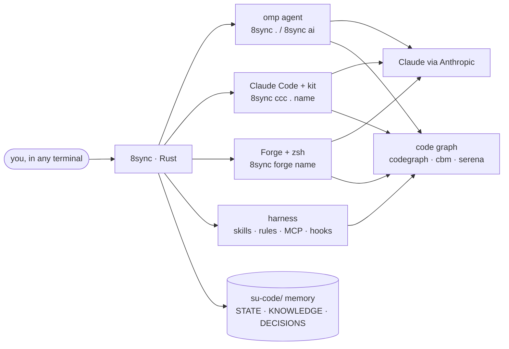

<div align="center">


[](https://github.com/8-Sync-Dev/su-code/releases/latest)
[](crates/cli)
[](#install)
[](LICENSE)

[Install](#install) · [Claude Code](#claude-code-8sync-ccc) · [Forge shell](#forge-the-ai-shell) · [Commands](#commands) · [Dashboard](#dashboard) · [Docs](https://8-sync-dev.github.io/su-code)

</div>

---

## Why 8sync

| | |
|---|---|
| **Rust core, one file** | A single static binary: 4.2 MB on Windows, 5.4 MB on linux-x86_64 (musl), no runtime to install. A size gate in CI fails any release that grows without an attributed reason. |
| **One line to a full AI workstation** | The installer drops the binary, then sets up gh, [omp](https://omp.sh), codegraph, [Forge](https://forgecode.dev) with zsh, [Claude Code](https://code.claude.com) with the 8sync kit, 50+ skills, MCP servers and global agent rules. Every step is idempotent and logged; a failed tool is reported and the rest still installs. |
| **Claude Code that finishes the job** | `8sync ccc . <name>` opens a named Claude Code session per repo. The kit adds subagents, `/ship`, a background compile check after every edit, every 8sync skill, the team's Usage Policy rules, and two gates: one keeps Claude working while it has unfinished work, the other sends questions it can answer itself back to it. [Details](#claude-code-8sync-ccc). |
| **Claude, the legitimate way** | Claude Code signs in with Anthropic's own login; Forge and omp use your own API key on the official API. No scraped web sessions, no shared accounts. [Details](#claude-the-official-way). |
| **A shell that is also an agent** | `8sync forge <name>` opens a fast zsh bound to a named Forge conversation: type commands as usual, prefix with `:` to ask Claude. |
| **Agents that know the code** | Code graph indexing (codegraph, codebase-memory-mcp, Serena), per-project memory in `su-code/`, and always-on engineering skills, so agents query structure instead of grepping blindly. |
| **Same commands everywhere** | Linux, macOS and Windows. On Windows there is no WSL requirement and no admin rights needed. zsh is provisioned privately next to Git for Windows. |
| **Updates itself, safely** | Every command checks for a new release in the background (throttled to once per 6 h). `8sync up` installs it with a sha256 check, even while sessions keep the old binary open; `8sync ccc` installs it on launch and re-runs on the new binary. |



---

## Install

```bash
curl -fsSL https://8-sync-dev.github.io/su-code/install | sh       # Linux / macOS
```

```powershell
irm https://8-sync-dev.github.io/su-code/install.ps1 | iex         # Windows PowerShell
```

You don't need git, Rust or admin rights. The installer verifies the binary's sha256 against the release, puts it on your PATH, then runs `8sync setup --no-profile`:

| Step | What you get |
|---|---|
| gh | GitHub CLI. Native package manager or winget; on Debian/Ubuntu, the official release tarball into `~/.local/bin` (no sudo). |
| omp | The coding agent ([oh-my-pi](https://omp.sh)), from its official installer. |
| codegraph | Semantic code index used by every agent. |
| Forge + zsh | Forge from its GitHub release. zsh comes from the system; on Windows it is a private MSYS2 zsh (sha256-pinned); on Linux without sudo, a static portable build. |
| Claude Code + kit | Claude Code from Anthropic's official installer, then the 8sync kit into `~/.claude` ([below](#claude-code-8sync-ccc)). |
| harness global | 50+ skills, `APPEND_SYSTEM.md` agent rules, MCP servers (codebase-memory-mcp, headroom, serena), hooks, context compaction at 50%. |
| PATH | `~/.local/bin`, `~/.cargo/bin`, `~/.bun/bin`, `~/.encore/bin` wired into zsh/bash/fish. |

A real run of the v0.63.0 one-liner on a fresh Ubuntu account without sudo:


Options: `SUSYNC_NO_SETUP=1` (binary only) · `SUSYNC_VERSION=v0.63.0` (pin) · `SUSYNC_BIN_DIR=~/bin` · `sh -s -- --uninstall`.
Run it again any time, or `8sync up`. Fallback URL: `https://raw.githubusercontent.com/8-Sync-Dev/su-code/main/install.sh`.

CI runs these exact one-liners on Ubuntu (x64 and arm64), macOS (Apple silicon and Intel) and Windows after every release and every week ([`install-smoke`](.github/workflows/install-smoke.yml)); a run fails unless the installed version is the latest and setup reports "all steps succeeded".

**Pro terminal (opt-in, any OS):** `8sync setup --profile terminal` installs:

- **helix** with a tuned config, plus the **JetBrainsMono Nerd Font**. On Windows the font also becomes the Windows Terminal default if you have none.
- **8sync's zsh**: two-line git-aware prompt, arrow-key completion menu, history suggestions, syntax highlighting.
- **kitty glass theme**, on Arch/Fedora only.

Then check everything with `8sync doctor`.

---

## Claude Code: `8sync ccc`

```bash
cd <project>
8sync ccc . core               # Claude Code session "core" in this repo (create or resume)
8sync ccc . core -p "…"        # one-shot; any flag after the name goes to claude
8sync ccc .                    # the session you used last
8sync ccc . ls | new <n> | rm <n>
8sync ccc kit                  # (re)install the kit; `8sync setup` already did
8sync ccc status               # claude, login, kit, sessions
```

Each name maps to a fixed conversation id per repo, so `8sync ccc . core` tomorrow continues today's thread, next to `8sync forge core` and `8sync . core` for the other agents.


Only want the subagents and `/ship`? They are also a Claude Code plugin in this repo's public marketplace (hooks, rules and the full skill set still come from `8sync ccc kit`):

```
/plugin marketplace add 8-Sync-Dev/su-code
/plugin install 8sync-kit@8sync
```

The kit lives in `~/.claude`, so it works in every repo and for plain `claude` too. Every `8sync ccc` launch also keeps things current, without network on the launch path: a newer 8sync release is installed and the command re-runs on it, the kit and bundled skills refresh after an update, and the repo gets the 8sync harness (memory, `AGENTS.md`/`CLAUDE.md` blocks, `.claude/skills` → `su-code/skills`). `SUSYNC_NO_AUTO_UPDATE=1` keeps the installed binary.

| Part | What it does |
|---|---|
| Org rules | A short summary of the 8 Sync rules for Anthropic's Usage Policy and terms loads in every session ahead of other instructions; the full text ([`8sync-anthropic-rules.md`](assets/skills/aup-audit/8sync-anthropic-rules.md)) opens on demand and in `/aup-audit`. |
| Subagents | Routed by role: `explore` and `quick-task` on Haiku (low effort), `task` and `reviewer` on Sonnet, `designer` on your session model, plus `researcher` and `verifier` for `deep-research`. Each has `maxTurns`; the read-only ones cannot edit; all return a short summary with details in a file. |
| Skills | `/ship <task>`: explore → task list → implement with build/test → `reviewer` → CHANGELOG + commit, never pushes. `/aup-audit`: Usage Policy + secret check before you publish. `deep-research`: cited research brief. Plus every 8sync skill: bundled ones linked to the current `~/.omp/skills` copy, project ones through `.claude/skills`; on-demand skills are listed by name only to keep the prefix small. |
| Verify hook | After every Edit/Write, runs `cargo check`, the package's `typecheck` script (or `tsc --noEmit`) or `go vet` from the edited file's nearest manifest **in the background**; only a failure comes back to Claude. The latest edit wins, so a burst of edits costs one check. Before a turn ends, the build must pass (blocked once per broken state). Native Rust, works on Windows. |
| Guard hook | Before Bash/Edit/Write: no writing `.env`/keys/`*.session`/`*.pkl`, no real-looking API key in code or commands, no `git add -A` that would sweep up a secret, no code routing a Claude subscription into another client. About 23 ms per call. |
| Stop gate | When Claude tries to end a turn, Haiku reads its last message. Planned steps not done, edits not verified, failing checks, `NOT MERGEABLE`, or a question it could answer itself: the turn goes on. Waiting on background agents it launched is fine. |
| Ask gate | Before Claude interrupts you with a question, Sonnet checks it. Only credentials, destructive or paid actions, and product decisions reach you; everything else goes back with "pick the conventional option and continue". |
| Defaults | Only where you haven't set them: auto permission mode, `medium` effort, a task list on every model. Build/test/lint commands and `git add` skip the auto-mode classifier. Deny rules for reading/editing `.env`, keys, `*.session`, `*.pkl` and for force-push; omp's `codebase-memory-mcp` + `serena` registered when installed (the kit says why not otherwise); Anthropic's official LSP plugins (rust-analyzer, TypeScript, gopls, pyright) enabled for the language servers on your PATH; a `SessionStart` digest of `su-code/STATE.md` and recent lessons. |

A real run with the kit. The first edit broke the build, the verify hook fed the compiler error back, and the stop gate refused "Next I will add tests":


Gate accuracy on labelled cases (the exact hook prompts sent to the model):

| Gate | Model | Correct |
|---|---|---|
| Stop | Haiku 4.5 | 18 / 18 (6 cases × 3 runs) |
| Ask | Sonnet 5 | 6 / 6 |
| Ask | Haiku 4.5 | 4 / 6, so not used |

Your edits win: a kit file you changed is kept (`8sync ccc kit --force` overwrites it), and `settings.json` is merged, never replaced.

Limits, so you know what you are getting:

- The stop gate judges Claude's last message, not the whole transcript. Claude Code stops after 8 forced continuations in a row.
- `AskUserQuestion` does not exist in `claude -p`, so the ask gate only acts in interactive sessions. If its model id is ever retired, the hook fails open and questions go through.
- The verify hook checks the whole package, not only the edited file. It runs in the background, so a slow `typecheck` delays only the end of the turn (timeout 600 s).
- `medium` effort is the kit default because it halved the time on the bench below with the same hidden-test result; switch a session to `/effort high` for hard reasoning.

### Speed next to omp (measured)

A harder task: an expression evaluator with three bugs and missing features across four files, 11 hidden tests, Sonnet 5 with a Console key, a fresh copy per run, up to four runs in parallel. Wall-clock per run:

| Harness | Runs | Mean | Hidden tests |
|---|---|---|---|
| omp | 155 · 124 · 136 s | 138 s | 11 · 10 · 11 of 11 |
| `8sync ccc`, kit 0.64 | 281 · 216 s | 249 s | 11 · 11 |
| `8sync ccc`, kit 0.65 at `high` effort | 209 · 179 s | 194 s | 11 · 11 |
| `8sync ccc`, kit 0.65 default (`medium`) | 100 · 161 s | 131 s | 11 · 11 |

Where the time went: in kit 0.64 every edit waited for `cargo check` (2.5 s warm, 8.6 s cold in this repo), every build/test command waited for the auto-mode classifier (~0.65 s), and Sonnet 5 at `high` effort wrote 17.6-20.6k output tokens per run against 9.4k and 15.3k at `medium`. Run-to-run spread is large (100 vs 161 s at the same settings), so read this as "on par with omp", not "faster". Anthropic's parallel-tool-call prompt snippet did not change how often Claude batched calls, so the kit doesn't use it. [Fast mode](https://code.claude.com/docs/en/fast-mode) (`/fast`, Opus only, higher price) is the remaining lever and stays your call.

### Tokens and quality next to omp (measured)

Same model (Sonnet 5, Console API key), same prompt, fresh copy of the repo per run, two runs per cell. Task A: implement a parser from a spec and fix three reported bugs (31 hidden tests). Task B: add save/load that survives hostile item names (20 hidden tests). Nobody saw the hidden tests.

| Harness | Hidden tests | Input tokens A · B | Requests A · B | Cost A · B |
|---|---|---|---|---|
| Claude Code, no kit | 31/31 · 20/20 (all runs) | 523k · 347k | 18 · 9.5 | $0.24 · $0.14 |
| `8sync ccc`, kit 0.63 | 31/31 · 20/20 | 555k · 344k | 19 · 10.5 | $0.26 · $0.16 |
| `8sync ccc`, kit 0.64 | 31/31 · 20/20 | 490k · 272k | 18.5 · 7.5 | $0.29 · $0.19 ¹ |
| omp | 31/31 · 20/20 | 274k · 208k | 8 · 7 | $0.25 · $0.13 |

¹ First runs on a new config dir, so the prompt cache was cold (cache writes 39-48k vs 18-30k); input tokens are the cache-independent number.

What this says, and what it doesn't:

- On these tasks every harness got every hidden test right. They do not show Claude Code verifying better than omp; the kit's gates matter on long runs where a model stops early, which these short tasks never triggered.
- Claude Code processes 1.3-2× omp's input tokens because it makes about twice the requests: it mostly calls one tool per request, omp batches. The cost is close anyway, since repeated context is billed as cache reads at a tenth of the price. Telling Claude to batch calls in `CLAUDE.md` changed nothing (about 1 in 7 requests had several calls with or without it), so the kit doesn't.
- In an 8sync repo the per-request prefix is where the kit saves: in this repo it is 34.3k tokens for `8sync ccc` 0.64, 41.0k for 0.63, 56.2k for omp. The difference is `CLAUDE.md`: 0.64 writes a 0.7k pointer block instead of a copy of the 8k skill list (importing `AGENTS.md` would cost 20.5k). 0.65 adds the always-loaded org rules and every skill by name: 41.1k in a fresh 8sync repo with 237 skills, against 57.3k if every description were listed.

---

## Claude, the official way

8sync never logs into claude.ai for another tool and never proxies a consumer subscription.

- **Claude Code** (`8sync ccc`) is Anthropic's own CLI. Sign in with `claude auth login` (your Claude plan) or `claude auth login --console` (API billing).
- **Forge and omp** use an API key from [console.anthropic.com](https://console.anthropic.com) against Anthropic's official API, under Anthropic's Commercial Terms:

```bash
8sync forge key sk-ant-...                 # Forge: stored in ~/.forge/.credentials.json, printed masked
export ANTHROPIC_API_KEY=sk-ant-...        # omp (`8sync .`, `8sync ai`): standard Anthropic env var
8sync forge key                            # list stored keys (masked)
```

Pick the model inside the tools: `/model` in Claude Code and omp, `:model` in a Forge shell. The keys stay on your machine, and 8sync never prints them in full.

> `8sync feynman auth-omp` bridges omp's other logins into Feynman but never Claude; give Feynman a Console key (`ANTHROPIC_API_KEY`). `8sync harness claude-code` with a non-Anthropic endpoint configures Claude Code only and leaves omp alone, and `8sync doctor` warns when omp is signed in to Anthropic with a Claude plan instead of an API key. Other bridges (`8sync codex-web`) and gateways are opt-in tools under their provider's terms.

The team's rules live in [`assets/skills/aup-audit/8sync-anthropic-rules.md`](assets/skills/aup-audit/8sync-anthropic-rules.md), ship inside the binary and load into every Claude Code session. A weekly workflow (`legal-sync`) snapshots Anthropic's own texts into [`docs/legal/anthropic/`](docs/legal/anthropic), commits any change and opens an issue to review the rules; with an `ANTHROPIC_API_KEY` repo secret, Claude Code drafts that update as a pull request.

---

## Forge: the AI shell

```bash
cd <project>
8sync forge core          # zsh bound to the "core" conversation (create or resume)
8sync forge core --tui    # same conversation in Forge's full-screen TUI
8sync forge core -p "…"   # one-shot prompt
8sync forge ls | new <n> | rm <n> | status
```

Each name maps to a persistent Forge conversation per repo, so `8sync forge core` tomorrow continues today's thread. In the shell, the prompt looks like this:


| Prompt part | Shows |
|---|---|
| `su-code/crates` | Path relative to the repo root |
| `on main` | Git branch |
| `core` | Session name |
| `FORGE 48.5k` | Agent and tokens used in this conversation |
| `claude-opus-5-5 MEDIUM` | Model and reasoning effort |
| `3.2s` | Duration of the last command, when it took ≥ 2 s |
| `❯` | Green after success, red after a failure |

| Type | Does |
|---|---|
| `: <prompt>` | Ask Forge in this session's conversation |
| `:<Tab>` | Forge commands: `:model`, `:provider`, `:agent`, `:new`, `:commit`… |
| `@<Tab>` | Attach a file to the prompt |
| `↑` / `↓` | History search by what you've typed |
| `→` | Accept the grey suggestion |
| `Tab` | Completion menu (arrows to pick, Shift+Tab back) |

Speed (Windows, measured in a pseudo-terminal):

- About 0.3 s from `8sync forge core` to a usable prompt.
- The Forge segment renders asynchronously, so the prompt never waits for it.
- Branch and repo come from `.git/HEAD` directly, with no `git` process per prompt.

Your own `~/.zshrc` loads first, and 8sync's managed files never overwrite it.

---

## Commands

### Daily loop

| Command | What it does |
|---|---|
| `8sync .` · `8sync . <name>` | Resume the project's omp session, or a named one. `. new <name> --worktree` gives a feature its own git worktree + branch; `. merge <name>` lands it locally. |
| `8sync ai "…"` | One-shot prompt; empty resumes the session. `--model <alias>` overrides the model. |
| `8sync ccc . <name>` | Claude Code session by name, with the kit ([above](#claude-code-8sync-ccc)). |
| `8sync forge <name>` | AI shell ([above](#forge-the-ai-shell)). |
| `8sync find <kw>` | ripgrep + fzf, opens `file:line` in your editor. |
| `8sync run dev\|build\|test\|fmt\|lint` | Project command from the detected stack. |
| `8sync ship "msg"` | add · commit · push · `gh pr create`. |
| `8sync note "msg"` | Append to `su-code/NOTES.md`; agents read it next session. |
| `8sync feature new <slug>` | Multi-phase feature plan with per-phase acceptance gates. |

### Harness

| Command | What it does |
|---|---|
| `8sync harness` | One idempotent command per repo: skills, codegraph index, `AGENTS.md` force-load block, `su-code/` memory. |
| `8sync harness init` · `create` | First bootstrap with managed `.gitignore` + gitleaks pre-commit hook · plus Cursor and Z.ai Code skill/rule fan-out. |
| `8sync harness global [--sweep]` | Apply rules, skills, MCP and hooks to every omp project on the machine. |
| `8sync harness web` | Local dashboard at `http://127.0.0.1:8731` (see below). |
| `8sync harness bench` · `toolstats` · `audit` · `eval` | Context budget · code-intelligence vs grep usage · doc hygiene · quality suite. |
| `8sync harness add-model` · `add-local-model` · `compaction` | Register a remote model · serve a local GGUF via mistral.rs · set the compaction threshold. |
| `8sync skill [add <url>[@ref] \| update \| gen]` | Skill library; `@ref` pins a commit in `skills.toml`. |

### Lifecycle

| Command | What it does |
|---|---|
| `8sync setup [--profile <name>] [--dry-run]` | Stage A harness + opt-in profiles: `terminal`, `dev-stack`, `nvidia`, `warp`, `bluetooth`. |
| `8sync up [--to vX.Y.Z]` | Self-update from GitHub Releases, sha256-verified. `8sync omp update` updates omp. |
| `8sync doctor` · `flow` · `help` | Health check · workflow-ordered help · cheatsheet. |

### Tools for agents

| Command | What it does |
|---|---|
| `8sync shot` · `diff-img` · `pdf-img` | Web page/file, git diff or PDF → PNG for vision models. |
| `8sync gen-img "…"` | Generate an image (`gpt-image-2`). |
| `8sync locate  "<target>"` | Visual grounding: boxes and click coordinates (LocateAnything-3B, non-commercial licence). |

### Machine (Linux desktop)

| Command | What it does |
|---|---|
| `8sync sec` · `vpn` | WARP + ufw toggle · SoftEther + VPN Gate relays. |
| `8sync bt` · `hz` · `lcd` | Bluetooth repair · highest refresh rate per display · Lian Li screens. |
| `8sync clean` · `theme` · `bg` | Disk/RAM cleanup · kitty palette · kitty wallpaper. |

Every verb has `-h` with an `EXAMPLES` block.

---

## Dashboard

`8sync harness web` serves an axum + React app embedded in the binary. Every page reads real files, and most pages write changes straight back to them.

| Group | Pages |
|---|---|
| Session | Live plan (`su-code/STATE.md`), token and compaction stats |
| Configure | Models per role, 50+ skills, memory files, rules |
| Runtime | Engines, code graph (call graph + Leiden clusters + caller tracing), MCP, submodules |
| Quality | Bench, readiness, team |
| Discover | One-click MCP servers and skills from the official registry, Smithery, Glama, mcp.so |


---

## Project memory

`8sync .` or `8sync harness` seeds a memory every AI tool reads (omp, Claude Code, Cursor, Forge, aider):

```text
<repo>/
├── AGENTS.md          anchor: force-loaded skills and rules
└── su-code/
    ├── STATE.md       the live plan, rewritten at every phase
    ├── KNOWLEDGE.md   validated lessons and recorded failures
    ├── DECISIONS.md   architecture decisions
    ├── PREFERENCES.md how you like things done
    ├── NOTES.md       `8sync note`
    └── skills/        project-local skills
```

---

## Build from source

```bash
git clone https://github.com/8-Sync-Dev/su-code && cd su-code
bash scripts/bootstrap.sh            # rustup if missing → cargo build --release → ~/.local/bin/8sync
```

| Topic | Details |
|---|---|
| Layout | `crates/cli/src/main.rs` routes; one file per verb in `crates/cli/src/verbs/`. |
| Embedded assets | Configs, skills and the zsh config in `assets/`, embedded with rust-embed. |
| Dashboard | Built from `web/` by `build.rs`. |
| Binary size | `bash scripts/size-report.sh` attributes size; `scripts/size-gate.sh` enforces the ceiling in CI. `--no-default-features` drops the dashboard (3.1 MB). |
| Releases | A `v*` tag builds 5 targets and publishes them with digests. |
| Contributing | [`AGENTS.md`](AGENTS.md) is the guide for contributors and their agents. |

---

## License

MIT, see [`LICENSE`](LICENSE). Built by [8 Sync Dev](https://github.com/8-Sync-Dev).
