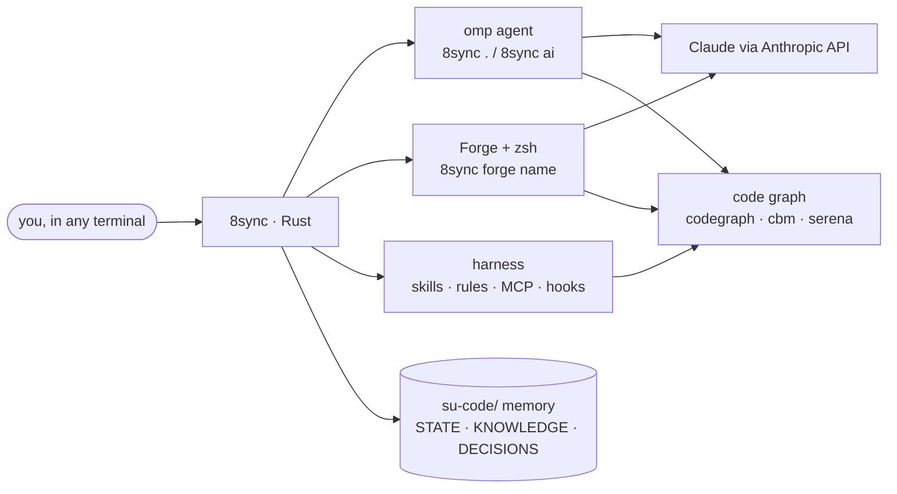

<div align="center">

# 8sync

**The Rust-native AI terminal harness of the 8 Sync team.**
One binary turns any terminal into an AI engineering workstation: agents, Claude, Forge, code intelligence, memory and skills, set up with one line.

[](https://github.com/8-Sync-Dev/su-code/releases/latest)
[](crates/cli)
[](#install)
[](LICENSE)

[Install](#install) · [Claude](#claude-on-the-official-anthropic-api) · [Forge shell](#forge-the-ai-shell) · [Commands](#commands) · [Dashboard](#dashboard) · [Docs](https://8-sync-dev.github.io/su-code)

</div>

---

## Why 8sync

| | |
|---|---|
| **Rust core, one file** | A single static binary: 4.2 MB on Windows, 5.4 MB on linux-x86_64 (musl), no runtime to install. A size gate in CI fails any release that grows without an attributed reason. |
| **One line to a full AI workstation** | The installer drops the binary, then sets up gh, [omp](https://omp.sh), codegraph, [Forge](https://forgecode.dev) with zsh, 50+ skills, MCP servers and global agent rules. Every step is idempotent and logged; a failed tool is reported and the rest still installs. |
| **Claude, the legitimate way** | Claude runs on the official Anthropic API with your own key. No scraped web sessions, no shared accounts. [Details](#claude-on-the-official-anthropic-api). |
| **A shell that is also an agent** | `8sync forge <name>` opens a fast zsh bound to a named Forge conversation: type commands as usual, prefix with `:` to ask Claude. |
| **Agents that know the code** | Code graph indexing (codegraph, codebase-memory-mcp, Serena), per-project memory in `su-code/`, and always-on engineering skills, so agents query structure instead of grepping blindly. |
| **Same commands everywhere** | Linux, macOS and Windows. On Windows there is no WSL requirement and no admin rights needed. zsh is provisioned privately next to Git for Windows. |
| **Updates itself, safely** | Every command checks for a new release in the background (throttled to once per 6 h). `8sync up` installs it with a sha256 check, even while sessions keep the old binary open. |



---

## Install

```bash
curl -fsSL https://8-sync-dev.github.io/su-code/install | sh       # Linux / macOS
```

```powershell
irm https://8-sync-dev.github.io/su-code/install.ps1 | iex         # Windows PowerShell
```

You don't need git, Rust or admin rights. The installer verifies the binary's sha256 against the release, puts it on your PATH, then runs `8sync setup --no-profile`:

| Step | What you get |
|---|---|
| gh | GitHub CLI. Native package manager or winget; on Debian/Ubuntu, the official release tarball into `~/.local/bin` (no sudo). |
| omp | The coding agent ([oh-my-pi](https://omp.sh)), from its official installer. |
| codegraph | Semantic code index used by every agent. |
| Forge + zsh | Forge from its GitHub release. zsh comes from the system; on Windows it is a private MSYS2 zsh (sha256-pinned); on Linux without sudo, a static portable build. |
| harness global | 50+ skills, `APPEND_SYSTEM.md` agent rules, MCP servers (codebase-memory-mcp, headroom, serena), hooks, context compaction at 50%. |
| PATH | `~/.local/bin`, `~/.cargo/bin`, `~/.bun/bin`, `~/.encore/bin` wired into zsh/bash/fish. |

Options: `SUSYNC_NO_SETUP=1` (binary only) · `SUSYNC_VERSION=v0.61.3` (pin) · `SUSYNC_BIN_DIR=~/bin` · `sh -s -- --uninstall`.
Run it again any time, or `8sync up`. Fallback URL: `https://raw.githubusercontent.com/8-Sync-Dev/su-code/main/install.sh`.

**Pro terminal (opt-in, any OS):** `8sync setup --profile terminal` installs:

- **helix** with a tuned config, plus the **JetBrainsMono Nerd Font**. On Windows the font also becomes the Windows Terminal default if you have none.
- **8sync's zsh**: two-line git-aware prompt, arrow-key completion menu, history suggestions, syntax highlighting.
- **kitty glass theme**, on Arch/Fedora only.

Then check everything with `8sync doctor`.

---

## Claude on the official Anthropic API

8sync never logs into claude.ai for you and never proxies a consumer subscription. The supported Claude path is an API key from [console.anthropic.com](https://console.anthropic.com), used against Anthropic's official API under Anthropic's Commercial Terms.

```bash
8sync forge key sk-ant-...                 # Forge: stored in ~/.forge/.credentials.json, printed masked
export ANTHROPIC_API_KEY=sk-ant-...        # omp (`8sync .`, `8sync ai`): standard Anthropic env var
8sync forge key                            # list stored keys (masked)
```

Pick the model inside the tools: `:model` in a Forge shell, `/model` in omp. The keys stay on your machine, and 8sync never prints them in full.

> Bridges such as `8sync codex-web` or `8sync feynman auth-omp`, and third-party gateways (`8sync harness gateway`), are separate opt-in tools. Whether a given account or reseller may be used that way is governed by that provider's terms, not by 8sync.

---

## Forge: the AI shell

```bash
cd <project>
8sync forge core          # zsh bound to the "core" conversation (create or resume)
8sync forge core --tui    # same conversation in Forge's full-screen TUI
8sync forge core -p "…"   # one-shot prompt
8sync forge ls | new <n> | rm <n> | status
```

Each name maps to a persistent Forge conversation per repo, so `8sync forge core` tomorrow continues today's thread. In the shell, the prompt looks like this:

```text
su-code/crates on main · core   FORGE 48.5k   claude-opus-5-5 MEDIUM 3.2s
❯ cargo test
```

| Prompt part | Shows |
|---|---|
| `su-code/crates` | Path relative to the repo root |
| `on main` | Git branch |
| `core` | Session name |
| `FORGE 48.5k` | Agent and tokens used in this conversation |
| `claude-opus-5-5 MEDIUM` | Model and reasoning effort |
| `3.2s` | Duration of the last command, when it took ≥ 2 s |
| `❯` | Green after success, red after a failure |

| Type | Does |
|---|---|
| `: <prompt>` | Ask Forge in this session's conversation |
| `:<Tab>` | Forge commands: `:model`, `:provider`, `:agent`, `:new`, `:commit`… |
| `@<Tab>` | Attach a file to the prompt |
| `↑` / `↓` | History search by what you've typed |
| `→` | Accept the grey suggestion |
| `Tab` | Completion menu (arrows to pick, Shift+Tab back) |

Speed (Windows, measured in a pseudo-terminal):

- About 0.3 s from `8sync forge core` to a usable prompt.
- The Forge segment renders asynchronously, so the prompt never waits for it.
- Branch and repo come from `.git/HEAD` directly, with no `git` process per prompt.

Your own `~/.zshrc` loads first, and 8sync's managed files never overwrite it.

---

## Commands

### Daily loop

| Command | What it does |
|---|---|
| `8sync .` · `8sync . <name>` | Resume the project's omp session, or a named one. `. new <name> --worktree` gives a feature its own git worktree + branch; `. merge <name>` lands it locally. |
| `8sync ai "…"` | One-shot prompt; empty resumes the session. `--model <alias>` overrides the model. |
| `8sync forge <name>` | AI shell (above). |
| `8sync find <kw>` | ripgrep + fzf, opens `file:line` in your editor. |
| `8sync run dev\|build\|test\|fmt\|lint` | Project command from the detected stack. |
| `8sync ship "msg"` | add · commit · push · `gh pr create`. |
| `8sync note "msg"` | Append to `su-code/NOTES.md`; agents read it next session. |
| `8sync feature new <slug>` | Multi-phase feature plan with per-phase acceptance gates. |

### Harness

| Command | What it does |
|---|---|
| `8sync harness` | One idempotent command per repo: skills, codegraph index, `AGENTS.md` force-load block, `su-code/` memory. |
| `8sync harness init` · `create` | First bootstrap with managed `.gitignore` + gitleaks pre-commit hook · plus Cursor and Z.ai Code skill/rule fan-out. |
| `8sync harness global [--sweep]` | Apply rules, skills, MCP and hooks to every omp project on the machine. |
| `8sync harness web` | Local dashboard at `http://127.0.0.1:8731` (see below). |
| `8sync harness bench` · `toolstats` · `audit` · `eval` | Context budget · code-intelligence vs grep usage · doc hygiene · quality suite. |
| `8sync harness add-model` · `add-local-model` · `compaction` | Register a remote model · serve a local GGUF via mistral.rs · set the compaction threshold. |
| `8sync skill [add <url>[@ref] \| update \| gen]` | Skill library; `@ref` pins a commit in `skills.toml`. |

### Lifecycle

| Command | What it does |
|---|---|
| `8sync setup [--profile <name>] [--dry-run]` | Stage A harness + opt-in profiles: `terminal`, `dev-stack`, `nvidia`, `warp`, `bluetooth`. |
| `8sync up [--to vX.Y.Z]` | Self-update from GitHub Releases, sha256-verified. `8sync omp update` updates omp. |
| `8sync doctor` · `flow` · `help` | Health check · workflow-ordered help · cheatsheet. |

### Tools for agents

| Command | What it does |
|---|---|
| `8sync shot` · `diff-img` · `pdf-img` | Web page/file, git diff or PDF → PNG for vision models. |
| `8sync gen-img "…"` | Generate an image (`gpt-image-2`). |
| `8sync locate  "<target>"` | Visual grounding: boxes and click coordinates (LocateAnything-3B, non-commercial licence). |

### Machine (Linux desktop)

| Command | What it does |
|---|---|
| `8sync sec` · `vpn` | WARP + ufw toggle · SoftEther + VPN Gate relays. |
| `8sync bt` · `hz` · `lcd` | Bluetooth repair · highest refresh rate per display · Lian Li screens. |
| `8sync clean` · `theme` · `bg` | Disk/RAM cleanup · kitty palette · kitty wallpaper. |

Every verb has `-h` with an `EXAMPLES` block.

---

## Dashboard

`8sync harness web` serves an axum + React app embedded in the binary. Every page reads real files, and most pages write changes straight back to them.

| Group | Pages |
|---|---|
| Session | Live plan (`su-code/STATE.md`), token and compaction stats |
| Configure | Models per role, 50+ skills, memory files, rules |
| Runtime | Engines, code graph (call graph + Leiden clusters + caller tracing), MCP, submodules |
| Quality | Bench, readiness, team |
| Discover | One-click MCP servers and skills from the official registry, Smithery, Glama, mcp.so |


---

## Project memory

`8sync .` or `8sync harness` seeds a memory every AI tool reads (omp, Claude Code, Cursor, Forge, aider):

```text
<repo>/
├── AGENTS.md          anchor: force-loaded skills and rules
└── su-code/
    ├── STATE.md       the live plan, rewritten at every phase
    ├── KNOWLEDGE.md   validated lessons and recorded failures
    ├── DECISIONS.md   architecture decisions
    ├── PREFERENCES.md how you like things done
    ├── NOTES.md       `8sync note`
    └── skills/        project-local skills
```

---

## Build from source

```bash
git clone https://github.com/8-Sync-Dev/su-code && cd su-code
bash scripts/bootstrap.sh            # rustup if missing → cargo build --release → ~/.local/bin/8sync
```

| Topic | Details |
|---|---|
| Layout | `crates/cli/src/main.rs` routes; one file per verb in `crates/cli/src/verbs/`. |
| Embedded assets | Configs, skills and the zsh config in `assets/`, embedded with rust-embed. |
| Dashboard | Built from `web/` by `build.rs`. |
| Binary size | `bash scripts/size-report.sh` attributes size; `scripts/size-gate.sh` enforces the ceiling in CI. `--no-default-features` drops the dashboard (3.1 MB). |
| Releases | A `v*` tag builds 5 targets and publishes them with digests. |
| Contributing | [`AGENTS.md`](AGENTS.md) is the guide for contributors and their agents. |

---

## License

MIT, see [`LICENSE`](LICENSE). Built by [8 Sync Dev](https://github.com/8-Sync-Dev).
