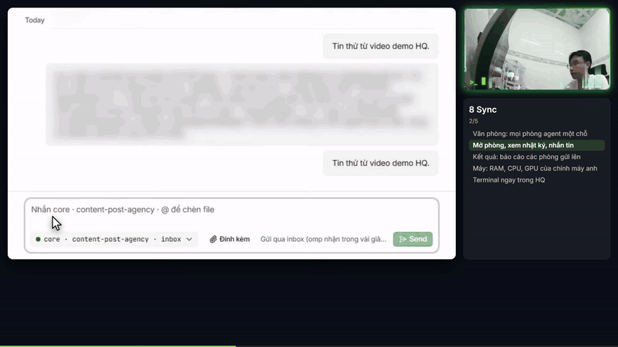
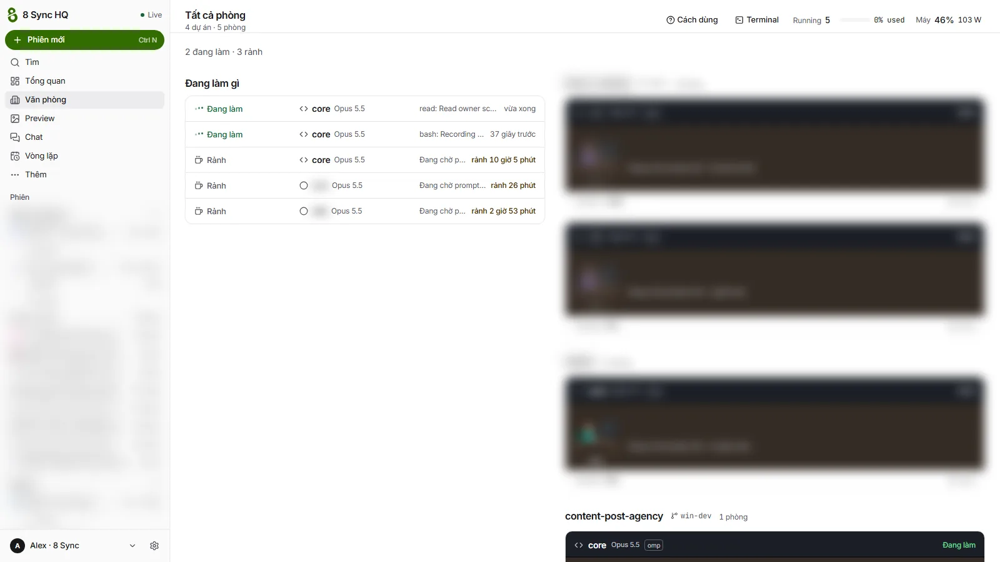
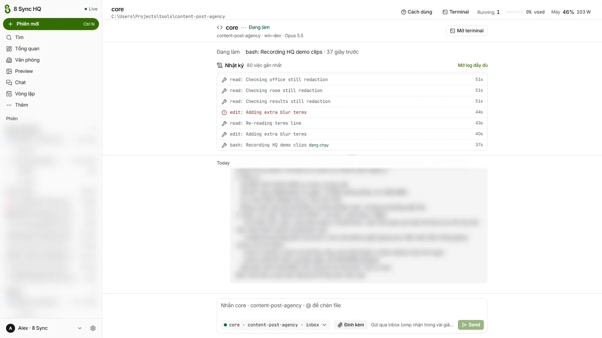
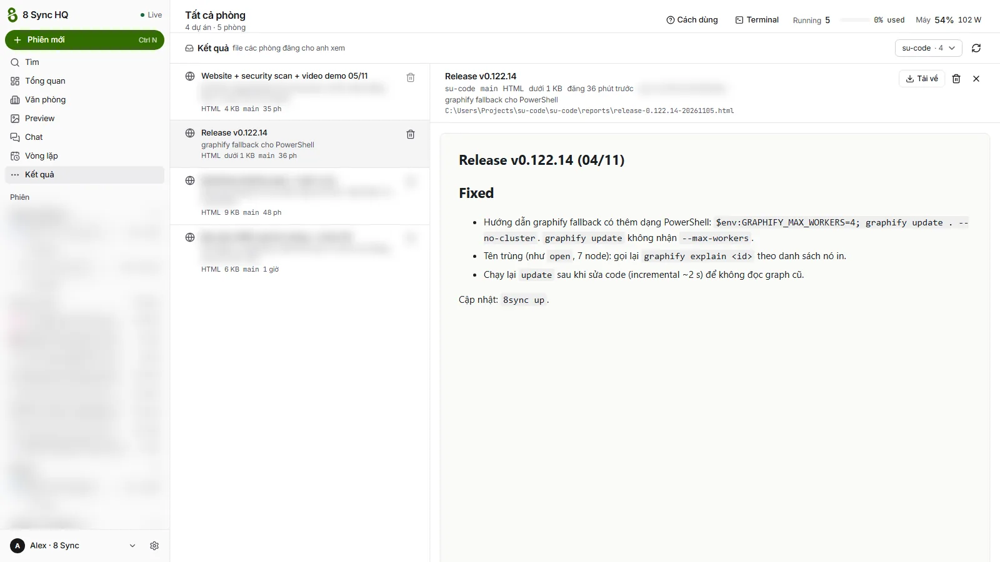

<div align="center">


# 8sync

**One command opens any coding agent in your repo. One HQ shows them all.**

[](https://github.com/8-Sync-Dev/8sync/releases/latest)
[](#install)
[](COMMERCIAL.md)

[Website](https://get.8syncdev.com) · [Install](#install) · [Quick start](#quick-start) · [Engines](#engines) · [HQ](#8-sync-hq) · [Tiếng Việt](docs/huong-dan.md)

</div>

`8sync` is a single Rust binary from 8 Sync. `8sync . <name>` opens a named coding-agent session in the current repo, or resumes it if it exists. `8sync hq ui` puts every session on the machine in one local dashboard, which you can also open from your phone.

omp and Claude Code are the engines we run every day and test; omp is the default. The long-term goal is every coding-agent CLI, each one visible and controllable from HQ.



## Install

```bash
curl -fsSL https://get.8syncdev.com/install | sh      # Linux / macOS
```

```powershell
irm https://get.8syncdev.com/install.ps1 | iex        # Windows PowerShell
```

No git, Rust or admin rights. The installer checks the binary's sha256, puts it on your PATH, then sets up gh, omp, Claude Code with the 8sync kit, Forge with zsh, skills and MCP servers. Every step is idempotent; a step that fails is reported and the rest still installs. Check with `8sync doctor`, update with `8sync up`.

## Quick start

```bash
cd my-app
8sync . api                           # omp session "api" in this repo: create or resume
8sync . api --mode claude-code-cli    # the same, on Claude Code with the 8sync kit
8sync hq ui                           # every session in a dashboard on http://127.0.0.1:8740
8sync hq ui --public                  # plus a one-time login link for your phone
```

Each name is one conversation per repo, so `8sync . api` tomorrow continues today's thread. 8sync never opens a session or sends a prompt on its own: every session is one you open, in a terminal or from HQ.

## Engines

Pick the engine with `--mode`; set `SUSYNC_MODE` to change your default.

| Engine | `--mode` | Status |
|---|---|---|
| [omp](https://omp.sh) | `omp` (default) | Tested daily |
| [Claude Code](https://code.claude.com) | `claude-code-cli` (aliases `claude`, `ccc`) | Tested daily, runs with the 8sync kit |
| [Forge](https://forgecode.dev) | `forgecode` (alias `forge`) | Supported |
| Codex CLI | `codex-cli` | Planned, not available yet |

**Claude Code mode** loads the 8sync kit from `~/.claude`: a guard that refuses deletes outside the repo, force-pushes and printing `.env` or keys; a verify hook that runs the build after every edit; stop and ask gates that keep Claude working instead of ending on a plan; and `/ship`, `/ship-loop`, `/autopilot` for hands-off work that still waits for one `Ship` answer before anything merges. Bypass mode is locked. Its own verbs: `8sync ccc help`.

**Sign-in, the official way.** Claude Code signs in with Anthropic's own login (`claude auth login`). omp and Forge use your own API key against the provider's official API. 8sync never proxies a consumer subscription. The team's rules: [`8sync-anthropic-rules.md`](assets/skills/aup-audit/8sync-anthropic-rules.md).

## 8 Sync HQ

`8sync hq ui` serves a local web dashboard on `127.0.0.1:8740`: which session is working and which waits on you, each room's log and chat, the reports sessions post, a web terminal, and the machine's RAM, CPU and GPU. `--public` prints a login link through a Cloudflare quick tunnel (needs `cloudflared`); anyone with the link controls your sessions, so keep it to yourself. For a fixed address on your own Cloudflare domain, run `8sync hq ui --tunnel-setup hq.example.com` once; `--public` then always uses `https://hq.example.com` (`--tunnel-off` goes back to the quick tunnel).

| Office | A room's log |
|---|---|
|  |  |



Screenshots and the [81-second walkthrough](docs/assets/hq-demo.mp4) (Vietnamese voice-over) come from a real HQ; private data is blurred.

## Project memory

`8sync .` seeds a memory every agent reads at start, whichever engine runs:

```text
<repo>/
├── AGENTS.md          the 8sync block: STEP 0 (trail code map) and memory rules
└── su-code/
    ├── STATE.md       the live plan
    ├── KNOWLEDGE.md   validated lessons and recorded failures
    └── DECISIONS.md   architecture decisions
```

## Docs

- [docs/huong-dan.md](docs/huong-dan.md): the full guide, in Vietnamese
- [AGENTS.md](AGENTS.md): every verb and option, layout, build and release rules
- [docs/hq.md](docs/hq.md): HQ on Discord · [docs/known-issues.md](docs/known-issues.md)
- [CHANGELOG.md](CHANGELOG.md) · `8sync --help` · `8sync ccc help`

Build from source: `git clone https://github.com/8-Sync-Dev/8sync && cd 8sync && bash scripts/bootstrap.sh`.

## License

Source-available under the [PolyForm Noncommercial License 1.0.0](LICENSE): free for personal study, hobby projects, research, education, charities and government. Use at or for a company, client work, or a paid product or service needs a commercial license; see [`COMMERCIAL.md`](COMMERCIAL.md). Releases up to and including v0.98.4 stay under MIT. Support the work on [GitHub Sponsors](https://github.com/sponsors/8syncdev). Built by [8 Sync](https://github.com/8-Sync-Dev).
